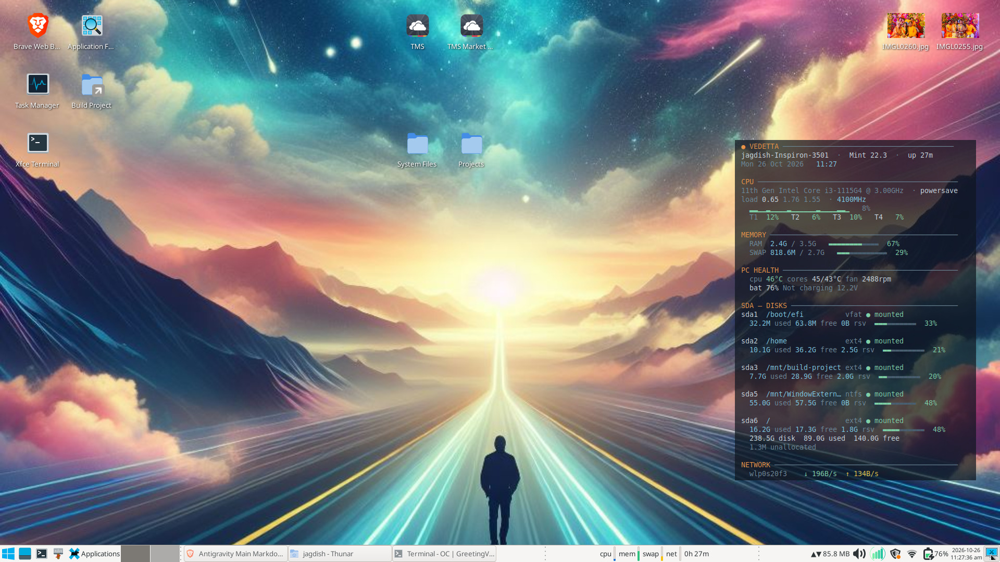

# Vedetta

> *The lookout post at the edge of your desktop.*

A translucent, draggable desktop panel for Linux that watches **every partition of a
disk** — including the ones that are not mounted — and reports used, free and
**reserved** space, next to CPU, memory, temperatures, fan and battery.

Built on [Conky](https://github.com/brndnmtthws/conky). Pure config + Bash: no daemon,
no web UI, no telemetry, no network traffic.



## Why another system monitor?

Because `df` only sees filesystems that are **mounted**. The moment you unmount a
partition, its free space disappears from every conventional widget. Vedetta joins
`lsblk` (which lists every partition) with `df` (which knows the numbers), so an
unmounted drive keeps its row and is clearly marked `○ unmounted` instead of silently
vanishing.

It also shows the **reserved** blocks that ext4 quietly keeps out of reach — the
difference between "18 GB free" and the space you can actually write to.

---

## Features

- **Per-partition disk table** — every partition of the target disk, mounted or not
- **Used / free / reserved / percentage**, with a proportional gauge per partition
- **Disk totals** — capacity, used, free, unallocated remainder, and an explicit
  note when only mounted filesystems are counted
- **Plain, LUKS, LVM and Btrfs layouts** — a filesystem mounted through a mapper
  device is traced back to the partition it lives on
- **CPU** — per-thread usage, average, 24-sample sparkline, frequency, load average
- **Memory** — RAM and swap with gauges
- **PC health** — package/core temperature, fan RPM, battery level, status and voltage
- **Network** — live up/down rates for active interfaces
- **Translucent**, sits under normal windows, never steals focus
- **Draggable** (Alt+drag) with the position remembered across reboots
- **Resizable** at runtime, 7–20 pt
- **Adjustable opacity**
- Zero runtime network, zero root, zero data collection

---

## Requirements

| Need | Notes |
|---|---|
| Linux with **X11** | Tested on Linux Mint 22.3 / XFCE 4.18. Wayland is not supported by Conky's transparency path. |
| A **compositor** | XFCE: *Settings → Window Manager Tweaks → Compositor → Enable display compositing*. Without it the background cannot be translucent. |
| `conky-std` | the renderer |
| `xdotool`, `xrandr` | optional — position memory and drag detection |
| A monospace font | **DejaVu Sans Mono** is the default and ships with virtually every distro |
| `bash` 5+ | for the collector |

Install the pieces on Debian/Ubuntu/Mint:

```bash
sudo apt-get install -y --no-install-recommends conky-std xdotool xrandr
```

`conky-all` also works, but pulls in audio/IRC/NVIDIA extras that Vedetta never uses.

---

## Install

```bash
git clone https://github.com/jagdishsah126/Vedetta.git
cd Vedetta
./install.sh
```

`install.sh` does not need root. It:

1. verifies Conky is present,
2. symlinks this folder to `~/.config/conky/vedetta`,
3. creates `~/.config/autostart/vedetta.desktop` so it starts with your session,
4. installs and enables the `vedetta-watch` user service (position memory),
5. starts the widget.

Because it is a **symlink**, editing the repository and running `vedetta restart`
is the whole development loop — no copying files around.

### After a desktop session restart

Autostart handles it. If it ever misses, `vedetta restart`.

---

## Uninstall

```bash
~/.config/conky/vedetta/uninstall.sh
```

That removes the symlink, the autostart entry, the watcher service and the cache.
Your repository and `state.lua` are left alone.

Remove Conky too, if you want:

```bash
sudo apt-get remove --purge conky-std
```

---

## Using it

The controller is `~/.config/conky/vedetta/bin/vedetta`. It is deliberately not on
`$PATH`; either use the full path or add an alias:

```bash
echo "alias vedetta='$HOME/.config/conky/vedetta/bin/vedetta'" >> ~/.bashrc
```

| Command | What it does |
|---|---|
| `vedetta start` | start the widget |
| `vedetta stop` | stop it |
| `vedetta restart` | stop + start (picks up edits to `conky.conf` automatically) |
| `vedetta toggle` | show / hide |
| `vedetta status` | process, window geometry, current scale/tint, log tail |
| `vedetta size 12` | set font size 7–20 pt (the whole panel scales) |
| `vedetta size +` / `size -` | step through sizes |
| `vedetta tint 40` | background opacity, 0 = invisible, 100 = solid |
| `vedetta save-pos` | store the current window position |
| `vedetta test` | print the panel as plain text in your terminal |

### Moving it — Alt+drag

Hold **Alt** and drag with the **left mouse button**. That is XFCE's standard window
move, and it works because the panel is a normal undecorated window that sits below
everything else.

The position is saved automatically: a tiny user service (`vedetta-watch`) notices when
the window has moved more than 16 px and writes the new offset to `state.lua`. Moves
smaller than that are ignored on purpose, so the window manager's settle-in nudge after
a restart is never mistaken for a drag.

Prefer a different position permanently? Just drag it, or edit `gapx` / `gapy` in
`state.lua` (distance from the **right** and **top** screen edges) and run
`vedetta restart`.

### Resizing

`vedetta size +` / `size -`, or an explicit value:

```bash
vedetta size 9      # compact
vedetta size 12     # comfortable
vedetta size 16     # presentation
```

Only the font size changes; the layout is measured in characters, so every column stays
aligned at any size.

Bind it to a key if you resize often — *Settings → Keyboard → Application Shortcuts*:

```
vedetta size +      →  Super+Shift+Up
vedetta size -      →  Super+Shift+Down
```

### Opacity

```bash
vedetta tint 0      # fully transparent (unreadable over a busy wallpaper)
vedetta tint 40     # light frosted panel
vedetta tint 71     # default
vedetta tint 100    # solid card
```

---

## Customizing

Everything visual lives in two small files. No rebuild step — `vedetta restart` applies
the change.

### Colours and thresholds — `bin/lib.sh`

```bash
C_HEAD='${color #E8924A}'   # section titles
C_TEXT='${color #C8D6E0}'   # body text
C_DIM='${color #6E8898}'    # secondary text, rules
C_ACC='${color #7EC8E3}'    # numbers
C_OK='${color #7FCFA8}'     # healthy
C_WARN='${color #E8C34A}'   # elevated
C_CRIT='${color #E86A5E}'   # critical
C_TRACK='${color #4A6072}'  # empty part of a gauge

TH_CPU_W=60; TH_CPU_C=85    # CPU %  warn / critical
TH_RAM_W=70; TH_RAM_C=88    # RAM %
TH_TMP_W=70; TH_TMP_C=85    # °C
TH_DSK_W=75; TH_DSK_C=90    # disk %
```

Values are `${color #RRGGBB}` strings in Conky markup — keep that form when editing.

### Width of the panel — `bin/lib.sh`

`COLS=54` is the character budget. If you change it, also update the width formula in
`conky.conf`:

```lua
local width = math.floor(54 * scale * 0.8031) + 22   -- 54 = COLS
```

### Which disk to watch — `bin/collect.sh`

```bash
DISK=${VEDETTA_DISK:-/dev/sda}
```

Either change the default, or override it per run and for the panel:

```bash
VEDETTA_DISK=/dev/nvme0n1 bash bin/collect.sh     # preview
VEDETTA_DISK=/dev/nvme0n1 vedetta restart         # apply
```

Everything downstream — partition list, mount state, section title, totals —
follows automatically.

To watch **two** disks, run a second Conky instance with its own config and a
different `VEDETTA_DISK`.

### Font

In `conky.conf`:

```lua
font = "DejaVu Sans Mono:size=" .. scale
```

Any installed monospace font works (`Ubuntu Mono`, `JetBrains Mono`, `Noto Sans Mono`).
Non-monospace fonts will break the column alignment — that is the one hard rule.

### Sections

Sections are emitted in order near the bottom of `bin/collect.sh`. Delete or reorder the
`emit "$(hdr …)"` blocks to hide a section; the spacer `echo` lines control the gaps.

### Update interval

```lua
update_interval = 2   -- seconds
```

The collector costs about 55 ms per run, so 2 s is cheap. Raise it to 3–5 s on a slow
machine or a battery-first setup.

---

## How it works

```
/proc · /sys · lsblk · df · sensors
              │
              ▼
        bin/collect.sh          ← the only logic; runs standalone
              │  emits Conky markup on stdout
              ▼
         conky.conf             ← window, geometry, font, transparency
              │  $execpi 2 …
              ▼
        the panel on screen
```

`bin/collect.sh` is deliberately runnable on its own:

```bash
bash ~/.config/conky/vedetta/bin/collect.sh
```

Whatever it prints is exactly what the panel shows — that is the debugging tool.

<details>
<summary>Sample output (plain text, colours stripped)</summary>

```
 ● VEDETTA ───────────────────────────────────────────
 workstation  ·  Linux Mint 22.3  ·  up 2h 38m
 Sat 24 Oct 2026   11:11

 CPU ────────────────────────────────────────────────
 11th Gen Intel Core i5-1135G7 @ 2.40GHz  · powersave
 load 1.79 2.92 2.84  · 4099MHz
   ▂▂▂▂▂▂▂▂▂▂▂▂▂▂▂▂▂▂▂▂▂▂▂▃  22%
   T1  24%   T2  24%   T3  19%   T4  24%

 MEMORY ─────────────────────────────────────────────
   RAM  1.7G / 7.6G   ▬▬▬▬▬▬▬▬▬▬ 24%
   SWAP 358.8M / 2.0G  ▬▬▬▬▬▬▬▬▬▬ 18%

 PC HEALTH ──────────────────────────────────────────
   cpu 65°C cores 65/62°C fan 3687rpm
   bat 61% Charging 12.4V

 SDA — DISKS ────────────────────────────────────────
 sda1  /boot/efi          vfat ● mounted
   32.2M used 63.8M free 0B rsv  ▬▬▬▬▬▬▬▬▬▬  33%

 sda2  /home              ext4 ● mounted
   9.3G used 37.1G free 2.5G rsv  ▬▬▬▬▬▬▬▬▬▬  20%

 sda3  /mnt/storage       ext4 ○ unmounted
   39.5G size  — used  — free  — rsv

 sda4  /                  ext4 ● mounted
   16.0G used 17.4G free 1.8G rsv  ▬▬▬▬▬▬▬▬▬▬  47%
   238.5G disk  25.4G used  54.5G free
   3 of 4 mounted — used/free cover mounted only
   1.3M unallocated

 NETWORK ────────────────────────────────────────────
   wlp0s20f3   ↓ 30.0K/s  ↑ 23.2K/s
```

</details>


| Section | Source |
|---|---|
| Partitions, sizes, filesystem types | `lsblk -b -P` |
| Mounted / unmounted, used, free | `df -B1 --output=…` |
| **Reserved** | `fs_size − used − available` |
| CPU % per thread | delta of `/proc/stat` between samples |
| CPU frequency | mean of `cpufreq/scaling_cur_freq` |
| Memory / swap | `/proc/meminfo` (`MemTotal − MemAvailable`) |
| Temperatures, fan | `/sys/class/hwmon/*`, resolved by driver name, never by index |
| Battery | `/sys/class/power_supply/BAT*` |
| Network rates | `rx_bytes` / `tx_bytes` deltas against a timestamped cache |

Runtime scratch (CPU history, rate samples, log, pid) lives in `~/.cache/vedetta/` —
a few dozen KB.

**Reserved space** is exact for ext4 (the 5 % root reserve) and reads `0B` for NTFS and
vfat, which have no equivalent. It is computed from `df`, so it needs no root.

**Totals are honest about what they count.** `used` and `free` come from `df`, which
only knows mounted filesystems, while `disk` is the physical capacity. When any
partition is unmounted the summary says so, instead of letting a partial sum read as
whole-disk usage:

```
   238.5G disk  26.3G used  53.6G free
   3 of 5 mounted — used/free cover mounted only
```

**Partitions behind LUKS/LVM/RAID** mount as `/dev/mapper/...`, not as `/dev/sdaN`.
Vedetta tries the direct device match first and only then walks the `lsblk` parent
chain, so an encrypted or LVM filesystem is still attributed to its partition instead
of appearing unmounted.

### Testing the unmounted path

You do not have to unmount a live filesystem to check the layout:

```bash
VEDETTA_FAKE_UNMOUNT=sda3 bash ~/.config/conky/vedetta/bin/collect.sh
```

Multiple devices: `VEDETTA_FAKE_UNMOUNT=sda3,sda4`.

---

## Troubleshooting

**Nothing appears.**
```bash
vedetta status
tail ~/.cache/vedetta/conky.log
```
Most often Conky started before the compositor. `vedetta restart` fixes it.

**The background is not translucent.**
1. The compositor must be on: `xfconf-query -c xfwm4 -p /general/use_compositing` → `true`.
2. In `conky.conf`, `own_window_transparent` must be **false**. This looks wrong but is
   not: Conky only honours `own_window_argb_value` (the tint) when transparency is off.

**Text is cut off on the right.**
Raise `text_buffer_size` in `conky.conf` (currently 40960) or lower `COLS`.

**The panel sits behind desktop icons.**
Desktop icons are drawn on the same layer. Either raise `gapx` in `state.lua` until the
panel clears the icon column, or turn desktop icons off in XFCE's desktop settings.

**The position moves after every restart.**
`systemctl --user status vedetta-watch.service` — it should be active. If it is, run
`vedetta save-pos` once with the panel where you want it.

**Position is not remembered, and the service is not active.**
The watcher needs `xdotool` and `xrandr`, and it needs to know which X display to talk
to. The installer writes the display it was run from into the unit, so install from
inside the graphical session, not over SSH. Re-run `./install.sh` after installing
`xdotool`/`xrandr`; without them the watcher is simply skipped and dragging still
works, it just is not saved.

**The disk totals look too small.**
They are correct — see the `N of M mounted` line. `used` and `free` come from `df` and
only cover mounted filesystems; `disk` is the physical capacity.

**Temperatures show `n/a`.**
Load the sensor modules: `sudo modprobe coretemp`, or run `sudo sensors-detect` once.

**Fan always reads 0 rpm.**
Some laptops only expose the fan through a vendor driver, and some expose none at all.
The field is skipped when unavailable.

---

## Files

```
.
├── conky.conf            window, geometry, font scale, transparency
├── state.lua.default     starting scale / position / tint (copied to state.lua on install)
├── bin/
│   ├── collect.sh        renders the whole panel
│   ├── lib.sh            palette, thresholds, gauges, byte formatting
│   └── vedetta           controller (start/stop/size/tint/save-pos/watch)
├── docs/
│   ├── DESIGN.md         design notes and decisions
│   └── preview.jpg       screenshot used in this README
├── install.sh
├── uninstall.sh
├── CREDITS.md            upstream sources and licences
└── LICENSE               MIT
```

Generated at install time (not in the repo): `state.lua`, the autostart entry, the
user service, `~/.cache/vedetta/`.

---

## Resource usage

Measured on a 2-core laptop running XFCE:

| Metric | Value |
|---|---|
| Conky RSS | ~15 MB |
| Conky CPU | ~0.5 % |
| Collector | ~55 ms every 2 s |
| Config + cache | < 100 KB |
| Network at runtime | **0** |

---

## Compatibility

Written against Conky **1.19** and tested on **Linux Mint 22.3 / XFCE 4.18 / X11**.
The configuration uses nothing exotic, so other X11 desktops (i3, Openbox, KDE with
compositing) should work with minor `own_window_hints` adjustments. Wayland is not
supported.

---

## License

**MIT** — see [LICENSE](LICENSE). Do what you like with it.

Conky itself is GPL-3.0; Vedetta only configures it and never links against its source.
Upstream projects that informed the design are credited in [CREDITS.md](CREDITS.md).
